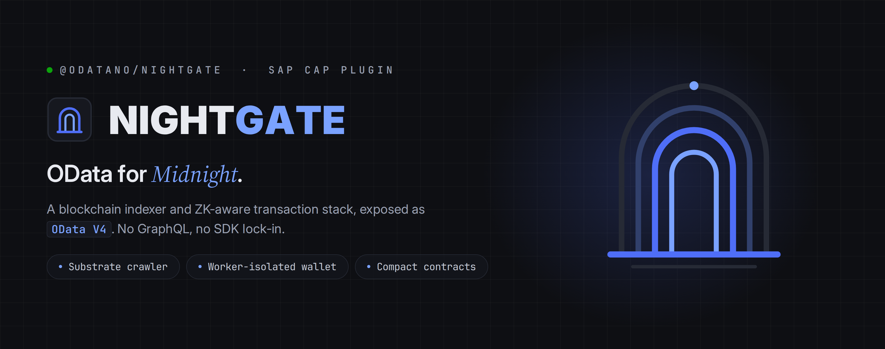

# NIGHTGATE - OData for Midnight @odatano/nightgate



**SAP CAP plugin: Midnight blockchain indexer + transaction submission, exposed as OData V4.**

[](https://github.com/ODATANO/NIGHTGATE/actions/workflows/test.yaml)
[](https://codecov.io/gh/ODATANO/NIGHTGATE)
[](https://www.npmjs.com/package/@odatano/nightgate)
[](https://www.npmjs.com/package/@odatano/nightgate)
[](https://www.npmjs.com/package/@odatano/nightgate-tx)
[](https://www.npmjs.com/package/@odatano/nightgate-tx)
[](https://cap.cloud.sap/)
[](LICENSE)

`@odatano/nightgate` is an indexer and transaction service for the [Midnight](https://midnight.network/) blockchain, built on SAP CAP. It runs as a plugin inside a CAP application or as a standalone container. A crawler indexes blocks from a Midnight node into CAP entities. A wallet stack in worker threads builds, proves and submits transactions: Compact deploys and calls, NIGHT and custom-token transfers, dust generation and fee sponsoring. Everything is exposed as OData V4.

It runs on Midnight ledger 9 networks.

## Ways to use it

- **Hosted**: call the gateway at `api.preview.odatano.dev` with a key. Start at the [hosted quickstart](https://api.preview.odatano.dev/quickstart).
- **Self-hosted**: run NIGHTGATE as a CAP plugin or container with a Midnight node and indexer behind it. See [docs/self-hosted.md](docs/self-hosted.md).
- **Library**: [`@odatano/nightgate-tx`](packages/nightgate-tx/README.md) builds, proves and signs on your machine and hands the transaction to a sponsor. See [docs/txbuilder.md](docs/txbuilder.md).

## Install as a CAP plugin

```bash
npm install @odatano/nightgate @cap-js/sqlite
```

```json
{
  "cds": {
    "requires": {
      "db": { "kind": "sqlite" },
      "nightgate": {
        "network": "mainnet",
        "nodeUrl": "ws://<node-host>:9944",
        "indexerHttpUrl": "http://<indexer-host>:8088/api/v4/graphql"
      }
    }
  }
}
```

Then `cds watch`. Every network but preview, testnet and undeployed needs `nodeUrl` and `indexerHttpUrl`. Preview has built-in public endpoints, so `network` alone is enough there. Proving runs in-process by default. All options: [docs/reference.md#configuration](docs/reference.md#configuration).

## Run the container

```bash
docker run -d -p 4004:4004 \
  -e ENCRYPTION_KEY=$(openssl rand -hex 32) \
  -e NIGHTGATE_HTTP_PASSWORD=change-me \
  -e NIGHTGATE_NODE_URL='ws://<node-host>:9944' \
  -e NIGHTGATE_INDEXER_HTTP_URL='http://<indexer-host>:8088/api/v4/graphql' \
  -v nightgate-data:/data \
  ghcr.io/odatano/nightgate:latest
```

Configuration, PostgreSQL and upgrades: [docs/docker.md](docs/docker.md).

## Services

| Service | Path | Content |
|---|---|---|
| `NightgateService` | `/odata/v4/midnight` | chain data, wallet sessions, token, contract, attestation and sponsoring actions |
| `NightgateIndexerService` | `/odata/v4/midnight-indexer` | sync state, health, metrics, crawler control |
| `NightgateAnalyticsService` | `/odata/v4/midnight-analytics` | aggregate counts |
| `NightgateAdminService` | `/odata/v4/midnight-admin` | sessions, contract registration, diagnostics |
| `NightgateVerifyService` | `/odata/v4/midnight-verify` | verification without credentials, with `NIGHTGATE_PUBLIC_VERIFY=true` |

Actions that write to the chain return `{ jobId, status }`. Poll `getJobStatus`. Every action: [docs/actions.md](docs/actions.md).

## Capabilities

- Block indexing with reorg rollback: `Blocks`, `Transactions`, `ContractActions`, `UnshieldedUtxos`, `NightBalances`.
- Wallet sessions: `connectWallet` with a viewing key, `connectWalletForSigning` with a BIP39 mnemonic. Keys are encrypted at rest.
- Transfers and dust: `sendNight` with optional `tokenTypeHex`, `registerForDustGeneration`, `deregisterFromDustGeneration`.
- Compact contracts: `deployContract`, `submitContractCall`, `submitContractCallBatch` on registered artifacts.
- Fee sponsoring: `sponsorSessionId` on submit actions, `sponsorFinalizedTransaction`, `sponsorUnboundTransaction`, `sponsorTransfer`, platform sponsors in `NIGHTGATE_FEE_SPONSOR_SESSION`.
- Documents and proofs: `anchorDocument`, `prepareDocumentProof`, field predicate, equality and membership attestations, cross-document integrity and diff attestations.
- Verification without the crawler: `verifyAttestationState`, `verifyPredicateState`.
- Disclosure: `grantDisclosure`, `revokeDisclosure`, `grantDisclosureToHolders`, `claimDisclosure`.
- Agents: `createAgentGrant` issues scoped tokens for the `x-agent-token` header. MCP server: [`@odatano/nightgate-mcp`](https://github.com/ODATANO/NIGHTGATE-MCP).
- Offer board: `postSwapOffer`, `listSwapOffers`, `sponsorSwap`, `mintFactoryToken`.
- Browser dApps: `@odatano/nightgate/browser`, `GET /zk-config/<contract>/...`, `GET /contract-manifest`.
- Operations: liveness, readiness, Prometheus metrics, crawler pause, resume and reindex.

## Documentation

- [Quickstart](docs/quickstart.md): first wallet-signed transaction
- [Self-hosted](docs/self-hosted.md): node and indexer behind your own instance
- [Docker](docs/docker.md): standalone container
- [Actions](docs/actions.md): every action and function with examples
- [Reference](docs/reference.md): configuration, services, entities
- [Operations](docs/operations.md): scripts, wallet sync, troubleshooting
- [Architecture](docs/architecture.md): threads, submission flow, persistence
- [Transaction builder](docs/txbuilder.md): build sponsorable transactions without a server
- [Changelog](CHANGELOG.md)

## Development

`npm run dev` runs `cds watch` with a 12 GB heap. Checks: `npm run typecheck`, `npm run lint`, `npm test`, `npm run check:release`. Scripts and e2e lanes: [docs/operations.md#scripts-at-a-glance](docs/operations.md#scripts-at-a-glance).

## License

[Apache-2.0](LICENSE)

## Links

- [ODATANO GitHub org](https://github.com/ODATANO)
- [Midnight Network](https://midnight.network/)
- [Consumer app implementation](https://github.com/ODATANO/NIGHTPASS)
- [SAP CAP documentation](https://cap.cloud.sap/docs/)
